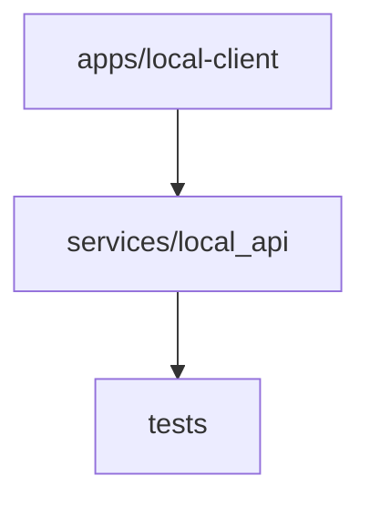

# 📚 my-workspace Documentation

Welcome to the complete documentation for this repository. This documentation is automatically generated and maintained by Woden Docbot.

  

## 🔗 Quick Links

[📂 apps](./apps/README.md) | [📂 services](./services/README.md) | [📂 tests](./tests/README.md)
[📋 Dependencies](./DEPENDENCIES.md)

---

> A local-first workspace repository that bundles a static front-end client, a FastAPI-based local API with local storage, and an accompanying pytest test suite.

## 📖 Overview

my-workspace organizes a self-contained local workspace: static front-end assets live under apps/local-client and provide the client UI entry (index.html), while a services package implements a local-only API and local-first storage for editing and persisting template and workspace data. The services/local_api subpackage exposes an app (app.py) built with FastAPI and Pydantic models and includes runtime and storage components for working with templates and workspace state.

A dedicated tests directory contains pytest-based unit and integration tests plus a browser-driven end-to-end suite that exercise the API, page rendering, workspace navigation, and version-specific behaviors. The codebase is implemented with HTML/CSS/JavaScript for the UI and Python for the service and test code, and depends on FastAPI, Pydantic and related Python tooling for runtime and testing.

### 🧩 Key Components

| Component | Purpose | Technologies |
| --- | --- | --- |
| **apps/local-client** | Contains the static front-end assets and main UI entry (index.html) for the local client workspace. | `HTML`, `CSS`, `JavaScript` |
| **services/local_api** | Implements a local-only template editor API, runtime entry point, and local-first storage components used to edit, persist, and serve template and workspace data. | `Python`, `FastAPI`, `Pydantic` |
| **tests** | Pytest-based suite with root integration/behavioral tests and a browser-driven end-to-end subdirectory to validate API, page handling, branding, and workspace navigation. | `Python`, `pytest`, `FastAPI` |

**Component Architecture:**

### 🏗️ Architecture

Top-level layout separates UI (apps/), service runtime and storage (services/), and a layered test suite (tests/) so a static client talks to a local FastAPI service backed by local-first storage and validated by pytest suites.

### 💡 Use Cases

- ✦ Edit, persist, and serve templates and workspace state locally via a FastAPI-based API
- ✦ Run a static local client workspace UI served from apps/local-client
- ✦ Validate API and UI behaviors with pytest and browser-driven end-to-end tests

### 🔧 Technologies

**Languages:**  

**Frameworks:** 

**Databases:** 
     

### 📦 External Dependencies

The following external packages are used across the project:

- `fastapi`
- `httpx`
- `pydantic`
- `pytest`
- `uvicorn`

---

## 📑 Documentation Sections

### [apps](./apps/README.md)
Top-level container for application front-end workspaces and client-facing app assets, organizing sub-projects such as the local client workspace.

The apps directory serves as a container for application-level front-end workspaces.

### [services](./services/README.md)
Hosts service-level components for the application, including a local-only API and local-first storage modules used for editing, persisting, and serving template and workspace data.

At the repository root level this directory contains package-level artifacts (for example an __init__.py) that mark the services package and may expose or aggregate service modules; the specific responsibilities of root-level files are not documented in the provided context.

### [tests](./tests/README.md)
Repository test suite containing local behavioral, integration, and page/workspace-focused tests that validate API, page handling, branding, and navigation behaviors.

The tests directory aggregates a set of pytest-based modules and browser-driven end-to-end suites that validate a local API and workspace behaviors.

---

## 📊 Documentation Statistics

- **Files Documented**: 27
- **Directories**: 8
- **Coverage**: 68%
- **Eligible Source Files**: 40
- **Last Updated**: 2026-11-18

---

## 🧭 How to Navigate

> ℹ️ **INFO**
> Each directory has its own README.md with detailed information about that section. Use the breadcrumb navigation at the top of each page to navigate back to parent directories.

### Navigation Features

- **Breadcrumbs** - At the top of each page, showing your current location
- **Directory READMEs** - Each folder has a comprehensive overview
- **File Documentation** - Click through to individual file documentation
- **Search** - Use GitHub's search or your IDE's search functionality

---

## 🤖 About Woden DocBot

This documentation is automatically generated and kept up-to-date by Woden DocBot, an AI-powered documentation assistant. DocBot analyzes code on every pull request and updates documentation to reflect changes.

### Features

- **Automatic Updates** - Documentation updates on every PR
- **Comprehensive Coverage** - Files, functions, classes, and directories
- **Smart Navigation** - Breadcrumbs, related files, and parent links
- **AI-Powered** - Uses Azure GPT models for intelligent documentation generation

---

*Generated by Woden DocBot for my-workspace*