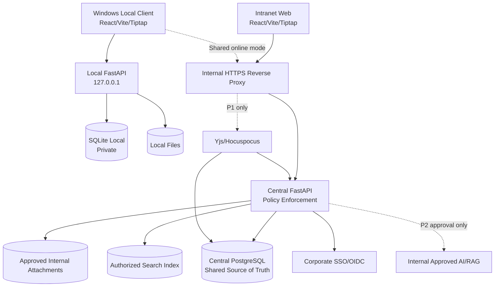

> **v0.5 안내:** 아래 문서는 v0.4 Hybrid Target 설계 자료입니다. 실행형 PoC 및 보안 제한의 우선 적용 기준은 [`SECURE_FEATURE_POLICY.md`](SECURE_FEATURE_POLICY.md), [`TEMPLATE_LIBRARY_SPEC.md`](TEMPLATE_LIBRARY_SPEC.md), [`DEVELOPMENT_ROADMAP_v05.md`](DEVELOPMENT_ROADMAP_v05.md)입니다. 모든 첨부·미디어·외부 연동/Export 언급은 현 시점에서 비활성화되며 승인 전 구현하지 않습니다.

# System Architecture — v0.4

## 1. Logical context

## 2. Boundaries
- **Local trust zone**: process scoped to Windows login; local UI via loopback; SQLite DB and local files. No inbound LAN listener; no default cloud, automatic remote sync or data telemetry.
- **Intranet shared zone**: central HTTPS endpoint, user-authenticated and policy-enforced CRUD, storage, search and audited administration. Intranet web can be accessed by approved staff without installing a local app.
- **P1 collaboration zone**: Hocuspocus must not become a backdoor to central documents. Authenticate at connection, authorize read/write action, revoke active connections if ACL changes, rate-limit/revalidate and persist Yjs binary state.
- **P2 AI zone**: retrieval only after ACL filter; permission check repeated before content is returned and prompt constructed.

## 3. Module map (Modular Monolith + isolated WS service)
Central FastAPI module boundaries: `identity`, `workspaces`, `pages`, `blocks`, `permissions`, `files`, `revisions`, `search`, `audit`, `publishing`, `health`. Shared repository/type packages describe contracts, **not** security source of truth. `collaboration` Node/Hocuspocus process becomes separate only at P1. Search starts as an API module + PostgreSQL index; no independent search service in MVP unless PoC proves a need.

## 4. Publishing data flow
1. User chooses explicit Publish in local app, previewing complete page and linked attachment list.
2. Local UI obtains approved company SSO session, selects target workspace, checks current destination rights and classification.
3. Local app serializes a **copy** and submits HTTPS API with opaque idempotency key; validate payload and attachments; server rechecks membership and destination rights.
4. Server writes central page, immutable initial revision, provenance without leaking private paths, audit event and search-outbox in transaction; binaries staged/committed with cleanup rules.
5. Server returns new central page ID; local original remains local. Errors/timeout require idempotent status resolution, never blind retry duplication.
6. Sharing is not bidirectional sync; subsequent edits on the two copies diverge intentionally until a later approved import/merge feature.

## 5. Shared write/read flows
- **P0 edit**: GET -> `revision`/ETag -> PATCH with `If-Match` -> optimistic transaction; 409 conflicts shown to user. Every read and write checks central ACL server-side.
- **P0 search**: query user-visible doc set; SQL/FTS filters by authorized resource IDs; materialized snippets built only after filter; no unauthorized result counts or titles.
- **P1 collaborative**: Hocuspocus WS token scoped to document and role; central ACL service authoritative; raw Yjs binary persisted with versioned snapshots; side effect queue triggers content projection/reindex.
- **P2 RAG**: index chunks tagged by source doc + ACL/version; retrieval filtered by current permissions at query time, revalidated before model context and answer. Deny tombstoned/revoked resources.

## 6. Architectural risks and alternatives
| Option | Why selected / excluded | Gate |
|---|---|---|
| React/Vite shared UI | lean local/intranet clients and common editor | Vite/CSP/offline build PoC |
| SQLite local + PostgreSQL central | local low-maintenance and central concurrency | migration, backup and authorization tests |
| Hocuspocus/Yjs P1 | mature CRDT real-time framework; separate process/operational cost | concurrency/licensing PoC |
| Dedicated microservices now | reject until scaling/coupling evidence | defer |
| Shared SQLite via NAS | reject concurrent network DB access | SQLite official guidance |
| Shared offline support in P0 | reject due to revocation and cache data-remanence risk | later Security ADR |

## 7. Deployment topology (proposed)
Local: approved Windows package (launcher + UI bundle + FastAPI/SQLite). Intranet: company reverse proxy/TLS, central API, PostgreSQL backups, approved file storage, SSO, logging. Web assets/self-hosted fonts bundled; outbound network deny except allowlisted corporate services. Central runtime may listen on an approved interface **behind** network controls; local runtime remains loopback-only.

## 8. Open questions
Endpoint ownership, HA/DR, corporate certificate handling, SSO provider/identity groups, security labels/retention, operational owners, mobile/browser policy, network proxies [확인 필요].
